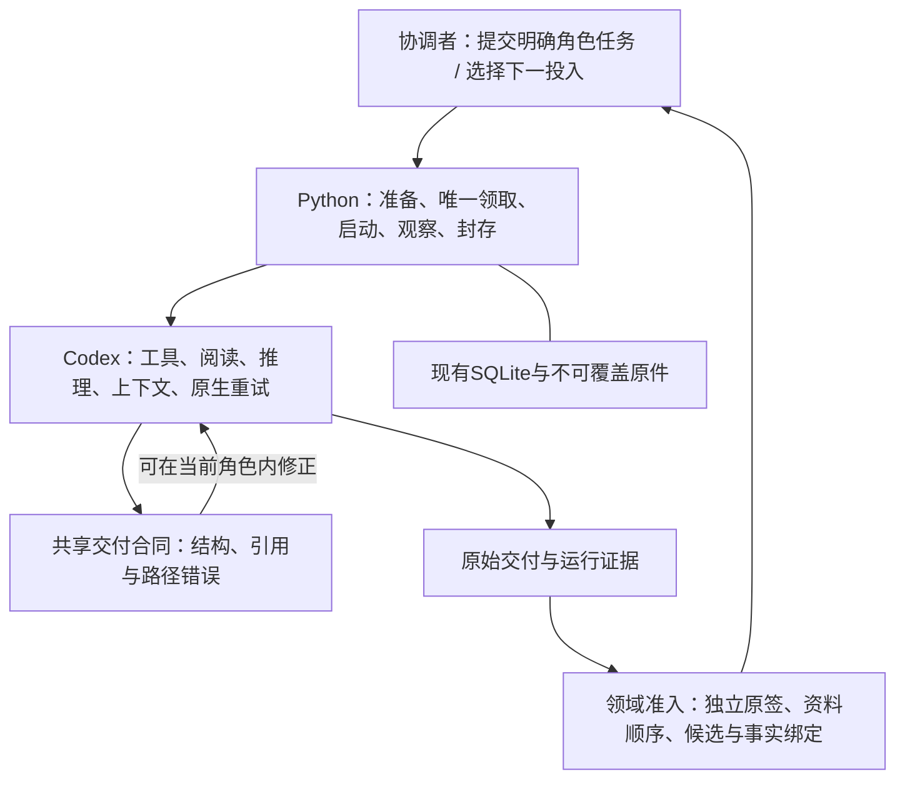

# Python 执行层重设计

状态：明确材料修订、质检、正式作答、事实与同会话评分入口已实施；公开原件适用关系与受影响复检接入新版solver。完整不可变运行包及新建作者/公开重建的专用任务入口仍未完成。接口见 `material-revisions.md`、`quality-tasks.md` 和 `formal-review-tasks.md`。

## 决策

Python 保留确定性的执行管理和领域准入校验。Codex 负责 Agent 循环、工具调用、阅读、上下文维护和角色内纠错；协调者负责任务选择、业务取舍、授权范围和下一投入。

收缩对象是重复状态机、提示编译、历史来源解释和按事故新增的恢复接口。文件完整性、唯一派发、资料隔离、独立质量和事实先封存再评分仍是程序必须执行的条件。

先改职责和失败处理，再迁模块。不能用移动文件、换语言或增加一个同样复杂的新框架作为完成标准。

## 当前代码的实际问题

当前实现已经使用 Codex 的 Agent 能力，并没有另造一个通用模型工具循环。`execution_runner` 启动 CLI、观察事件和采集文件。现有负担主要来自管理协议及业务流程层。

本次静态审计发现：

| 问题 | 当前归属与证据 | 后果 |
| --- | --- | --- |
| 同一工作被多层流程重复描述 | `execution_author` 包装质量 flow；`execution_lifecycle` 再包装 author/experiment；`execution_flow` 和 worker 各自保存游标 | 一个异常需要在多层恢复和重新核对 |
| 按具体故障增加恢复分支 | `execution_lifecycle.resume_path_transport` 包含 25 种恢复动作，若干动作匹配错误文字 | 每次表现变化容易要求新代码、新记录和新交接 |
| 存储层承担领域证明解释 | `ExecutionStore` 同时处理 SQL、领取、质量组合、历史闭合和别名路线 | 持久化、业务规则与来源运输耦合，修改影响面很大 |
| 生成、预检和接收契约分散 | 提示在 author/flow/experiment 拼接，报告由 contracts/store 接收 | 模型完成后才发现合同不符，技术完成被误读成业务可继续 |
| 角色会话生命周期选择不完整 | 普通 native role 默认 ephemeral，facts 和显式 serial quality 则有持久会话路径 | 有 SID 也可能没有可恢复上下文，报告纠错容易升级成整轮重做 |
| 可变源码路径进入运行依赖 | runner 显式锁定 repository 中的 provider/retry 源文件及调用方 dependencies | 升级管理代码可能让旧准备或采集校验失败，跨任务安装等待增加 |
| 阅读操作细节进入管理层 | serial quality 的页数、导航命令和响应字节限制由 Python 拼接 | Python 开始承担内容工作安排和上下文协议维护 |

审计时六个重点模块合计约 1.07 万行；执行 CLI 有 33 个子命令，另有 12 个 apply 操作、7 种 lifecycle kind。数量是结构信号，不作为删掉校验的理由。代码定位见文末。

## 目标分工

| 工作 | 负责人 | 程序执行的条件 |
| --- | --- | --- |
| 选题、下一研究、是否返修或重新质检 | 协调者 / 业务角色 | 明确任务和原授权范围 |
| 读材料、选方法、归属判断、签发业务结论 | Codex 中的独立角色 | 相应资料视图与交付合同 |
| 网络请求和流重连 | Codex 原生传输 | 使用实际支持的配置，分别记录业务重派 |
| 工具循环、上下文维护、压缩 | Codex | 不由 Python 重建上下文 |
| 报告格式和引用纠错 | 原角色的 Codex 上下文 | 只收到确定的合同错误，保持原资料与角色边界 |
| 唯一领取、调用状态、互斥与暂停 | Python 管理内核 | 事务与可重入观察，不承诺跨外部进程 exactly-once |
| 输入分包、实际字节、角色权限、产物封存 | Python | 启动前/接收前重验真实对象 |
| 质量门、候选绑定、facts 封存及同 reviewer 评分 | 独立领域合同 | 校验原签和顺序，不替模型签质量或评分 |
| 是否允许新的外发或付费尝试 | 既有用户授权与系统审批 | 不由恢复代码猜测扩大授权 |

逻辑角色不要求各自常驻一个协调聊天。内部调用继续使用当前仓库、SQLite 和官方 Codex CLI，不另建 Agent、工具、消息总线或 context 平台。

图中的回路由 Codex 在原轮内执行，或由有明确额度的原会话 follow-up 执行；Python 不自行推理并生成任意后继任务。一次新的 follow-up 仍是新的实际模型调用，须保留独立执行身份及额度消费记录。

## 一份明确任务，三个独立结果

### 任务说明

复用现有 work/intent、候选、角色配置、输入 manifest、权限配置、授权和交付契约，收敛成一次角色执行说明。该说明只有：

1. 任务、角色、候选版本和唯一意图。
2. 已确认的 provider、模型、推理设置、实际 CLI/runtime。
3. 本角色每阶段可见的输入视图与真实文件引用。
4. 输出合同和本地只读校验入口。
5. 会话模式及原会话绑定。
6. 已有授权、业务调用额度与需要的平台审批。

不把“做完后研究什么、修哪个问题、是否继续下一轮”编码成通用调度器的隐含规则。已经明确批准的有界计划可以携带确定的节点与条件；计划本身不从模型结果中自动扩展。

### 结果分层

当前多个 `accepted` 含义混在一起。新接口始终分别返回：

| 维度 | 示例值 | 含义 |
| --- | --- | --- |
| execution | not_started / running / completed / failed / unknown | 进程与可观察调用是否完成 |
| delivery | pending / valid / invalid | 交付是否满足结构、引用、路径及绑定合同 |
| outcome | accepted / revision_required / inconclusive 等原角色结论 | 真实角色签发的业务结果 |

另存系统审批状态与授权消费记录。`completed + invalid` 是可诊断的角色结果，不升级为父、子、实验三个流程同时抛出无法定位的异常。旧原签的业务结论照常保留，直到取得正常可接收结果；格式合格也不意味着业务通过。

公共接口先收敛为现有执行原语的薄适配：提交明确任务、运行一次、观察/采集、校验、在合规原会话中追加指令。接口名称和参数可在实现时沿现有 CLI 收敛，不先创建另一套业务 DSL。

## 合同前移，业务判断留给角色

生成约束、本地预检和接收必须引用同一个版本化合同与相同输入索引。共享的是纯校验规则，不是程序生成的业务结论。

新报告合同明确区分：

- 当前候选中的问题及候选修复目标。
- 独立试解中的正确、错误或遗漏观察。
- 执行环境与材料不确定性。

证据引用使用 manifest 中的 artifact ID 和类型化定位；`repair_targets` 的合法集合来自当前候选。试解观察可保留为试解观察，不能仅因路径错误在接收阶段被静默转换成候选缺陷或非阻断项。角色仍可能依据公开事实发现候选、参考或评分规则确有问题，必须自己签发归属和影响。

若交付不合法，校验器返回稳定的错误码、issue ID、字段路径及允许的引用集合。它不提供预填的正确答案、自动降级 severity、改写原文件或指定 accepted。原角色可以修正结构、重新判断归属，或如实保留未决。

现有 target-scope 共享预检是这一方向的局部实现，只覆盖其明确的规则；不能把它视作整个角色合同已统一。

## 会话由 Codex 管，生命周期由任务声明

将会话模式显式化：

| 模式 | 用途 | 接续规则 |
| --- | --- | --- |
| fresh_ephemeral | 不需后续纠错或分阶段材料的独立短任务 | 结束后不承诺恢复 |
| fresh_persistent | 需要阶段内纠错或公开先行/后续参考的角色任务 | 保存实际 session ID、role home、候选和能力绑定 |
| resume_existing | 已声明的阶段内纠错、serial 接续、facts→score | 只能用明确原 ID 和合法角色绑定，不能使用全局 latest |

首个独立质量使用新的独立上下文。原 QA 可以沿同一返修链对作者修改后的子版执行受影响复检，始终独立于作者和返修者；合法 revision_required 原审查同样可作为来源，不能虚构父版 accepted。复检是新的明确 quality 任务，保留旧签/问题、真实差异和新结论，不借结构纠错入口。已见教师资料的上下文标为知情复检；全新公开盲审另建独立上下文。原 ephemeral 会话不能追认成 persistent。

同题作者研究、设计、私有参考、制作及修订默认续接同一逻辑作者的持久上下文；当前 revision 入口已实现精确父子版本迁移。无法核原逻辑身份、原会话不可恢复、ephemeral 或明确换作者时，记录原因后 fresh。旧 author/lifecycle/experiment 执行入口不恢复。完整历史按现有 sources/归档索引提供，不重复拼接旧 trace 冒充上下文。

同角色指同一逻辑审查者及其候选/资料范围，不要求所有阶段的角色名相同。facts→score 按合法阶段从 `review-facts` 转为 `review-score`，必须保留原 provider、模型、policy、run、实际 SID 与 facts seal；不能借 resume 更换评阅上下文。

官方 CLI 支持非交互 `exec resume <SESSION_ID>`、JSON 事件及输出 schema；本机 help 也列出这些能力。它们提供载体原语，不证明当前自定义 provider、权限与阶段协议已经验证。未来持久模式的具体配置需要在任务自有 home、显式 SID 下验证，禁止通过扫描全局 session 目录找回身份。

公开先行和 facts→score 用同一真实会话里的明确材料阶段运输：先完成并封存检查点/事实，管理层核验后再沿合法 resume 追加下一阶段材料。上下文与工具循环继续由 Codex 执行。若原CLI/权限配置不能支持所需阶段变化，报告具体能力缺口，不拼接旧 trace 冒充原上下文。

格式纠错额度属于明确角色任务的执行策略，必须有原授权覆盖；新付费轮次和新的资料外发不因 `resume` 自动获得授权。优先在同一 Codex turn 内用预检完成纠错。

会话身份与执行身份分别留证：纯观察或重新采集继续引用原 attempt；每次实际 `exec resume` 则建立独立、不可覆盖的调用身份、锁定请求、唯一领取、终止、输出与采集记录，并消费明确的纠错/阶段额度。可以沿用既有 work/attempt 表达新调用，不能重开旧终态 attempt、runtime 或 collection-lock，也不需要新增并行的上下文框架。

## 恢复按执行事实处理

新管理内核只提供通用事实分类，具体下一投入由协调者决定：

| 情形 | 管理行为 |
| --- | --- |
| 未登记实际 attempt 的准备问题 | 保存原准备失败证据，修正条件后正常准备；已有 failed/unknown attempt 不重派，新调用须明确新 intent 和范围 |
| 已完成但尚未采集 | 对原尝试重新观察和采集，不执行模型 |
| 已完成但交付不合法 | 保留原文件和错误；有受支持原会话与额度时追加确定错误，否则向协调者返回未决 |
| 远端是否执行不明 | 标记 unknown，核证；不自动重入队 |
| 技术失败且需要新业务尝试 | 明确新意图、来源、用户范围与次数，沿统一提交入口 |
| 业务 revision_required / inconclusive | 返回原结论，由协调者选择具体后继 |
| 真实审批或权限拒绝 | 保留原因；正常审批未允许前停止相关动作 |

错误对象使用稳定分类和字段；英文报错字符串只作显示，不能作为新状态迁移的主键。网络重连归 Codex；它与业务重新派发、格式纠错和业务返修分别记录。

## 原件和来源验证只保留一份实现

存储层只保存事务对象、事件、唯一性约束与可查询引用。质量来源、规范范围、whole/affected 组合、负评闭合和评分依据验证放在独立领域合同中。

启动和接收时重新核真实字节仍有必要。可去掉的是在 author、experiment、lifecycle、store 分别展开同一份来源、重新解释含糊字段和寻找历史别名的多套实现。

优先使用当前候选、明确原签和直接的来源引用。whole/affected 的合法组合继续由领域合同验证真实签发和覆盖；不能为了让内核变薄而删除未闭缺陷守卫，也不能一律强制新 whole 导致不必要的重审费用。新任务只接受明确来源，不进入历史图搜索。历史记录保留原字节，不承担运行兼容。

## 固定运行依赖，解除可变管理源码耦合

对未来准备，把真正需要运行的 helper/provider/retry 源按内容复制入不可变 runtime bundle。manifest 的运行依赖指向 bundle；当前仓库版本另记为构建来源。

边界必须覆盖实际 consumer 的 imports、worker、CLI、解释器和被使用的资源，不能只复制 worker 就宣称独立升级。需要证明没有偷偷从活动仓库 fallback 的 import。

CLI/解释器升级是明确的新 runtime 版本，仍须真实能力证据。旧 manifest 的依赖不修改、不重算成当前文件。现有安装锁和活动流程保护持续适用；只有依赖闭包、采集兼容和启动屏障验证后，才逐步解除跨任务对管理源码安装的互斥。

这是一项迁移目标。当前证据只说明部分显式 provider/retry 活路径存在耦合；不能扩张成所有仓库源均被锁定，或宣称通用安装屏障已经在代码中实现。

## 按现有模块迁移

| 现有模块 | 目标职责 | 迁移方式 |
| --- | --- | --- |
| execution.py | 少量明确执行命令 | quality、solver、review 显式任务命令；删除旧质检及自动实验/轮次入口 |
| execution_store.py | SQLite、事件、领取、控制、唯一性 | 将领域证明委托同一现有校验实现，避免先复制一份规则 |
| execution_runner.py / provider / environment | Codex 载体适配 | 统一角色配置与会话模式、原生事件和不可变运行依赖 |
| execution_flow_contracts / quality helper | 单一版本交付合同 | 生成/同轮预检/接收共用规则，输出结构化错误 |
| execution_quality | 单个明确质检角色任务 | 复用队列、worker和采集，不自动安排业务返修或复检 |
| execution_solver / execution_solver_contracts | 单个公开正式作答任务与确定性合同 | 直接验证当前质量来源，生成公开资料视图并接收完整原卷 |
| execution_assessment / execution_assessment_contracts | 明确 facts、seal、score 与同阶段纠错 | 共用纯交付合同，评分只追加冻结标准，保留唯一原分 |
| execution_tasks | 角色任务共用的确定性小工具 | 复用现有锁、队列和唯一派发，校验原件与原生资料视图 |
| execution_revision | 独立副本、简明委托、完整差异和修订采集 | 明确任务复用queue/worker/runner，未变材料程序保留；不启动业务后继 |
| execution_quality_coverage / public_predecessor | 当前版有效审查范围与公开原件适用关系 | 重验旧原件及新版独立签发，旧签保持旧身份；不代签整包通过 |
| execution_flow / author | 历史作者与公开重建编排的内部依赖 | 旧author/lifecycle执行CLI已退役；新建公开任务用明确底层enqueue，不兼容旧链 |
| execution_lifecycle / experiment / execution_review | 已退役入口及尚存内部依赖 | 新质量、正式作答和评阅不经过旧父子恢复链；历史记录可读，不恢复旧任务执行 |
| execution_quality_reading/session | 领域检查点及原会话绑定 | 把阅读策略交给角色，保留实际顺序和责任证据 |

重设计不提供旧任务的运行兼容。旧质检命令直接删除；尚被其他角色调用的后端暂不连带删除。历史输入、终态、原签和成绩只保留读取与核验，不以兼容理由继续扩建旧流程。

## 实施顺序

### P0：固定基线与边界

保留当前可用版本和全部运行原件；记录角色、数据、授权、依赖与输出合同。停止新增事故型恢复分支。建立一个中性回归案例：试解有错误、题包没有该错误、质量报告的修复目标不合法。

完成条件：生产行为未被改写，已认领写入边界清楚，当前未决和历史成绩能正常读取。

### P1：交付错误成为角色内可处理结果

复用现有 enqueue/worker/collect，统一结构化错误返回与共享合同。先迁未来质量任务，显式声明会话模式。错误交付保存为一次不可覆盖版本，在有真实原会话和额度时由同一角色纠正。纯观察/重新采集不新建 attempt；实际新增 resume turn 必须按上述规则独立留证和消费额度。

完成条件：中性错误报告在交付前能定位错误；不能静默改变业务结论；格式纠正不要求重做作者和公开试解；没有原会话或授权时准确停住。

### P2：缩减重叠状态机和持久化职责

将确定的业务决定改成协调者提交的具体角色任务；存储层委托领域校验。保持公开重建、独立质检、正式作答、facts 和 score 的阶段边界，减少重复的父子游标与恢复传播。

完成条件：一个技术异常有一个执行状态和一份诊断；质量结果能直接查询；不会通过父子恢复链重复派发。自动后继只能来自已声明的有界计划。

### P3：固定运行包与配置编译

把多处 provider/权限/CLI 选项收敛为单一角色配置编译，产出不可变运行包。逐条验证完整依赖闭包及旧包采集，在此基础上减少共享源码升级等待。

完成条件：新管理版本不会改变旧运行包的哈希或采集能力；修改活动 provider 源不能污染旧包；缺失依赖立即拒绝，不能 fallback。

### P4：收缩旧入口

旧质检命令随新入口同时移除，不加兼容转发。按真实依赖继续删除退役实现；保留原始记录与稳定查询。

完成条件：删掉的是重复代码与解释分支，不是证据、业务约束或历史失败。

## 验证与衡量

优先使用标准库、中性 fixture、临时目录和受控 Codex 事件样例。真实外部 LLM 测试须另获明确授权；仅在离线验证无法证明实际载体行为时使用最小中性输入，单独记录真实调用、身份及费用未知边界。

必要回归包括：并发唯一领取；启动未知不重派；原尝试重复采集；结构错误与业务未通过分开；合法试解观察；真实候选缺陷；公开先行与参考阶段；facts→score 同 SID；外来 SID/错误 home 拒绝；新依赖包不读活动仓库；旧 manifest 字节不变；真实审批拒绝不被恢复动作覆盖。

持久会话和自定义 provider 的实际联调另按明确授权验证，不把模拟当真实运行。行覆盖率、业务结果、平台能力分别报告。

优化衡量使用：每个角色任务的管理耗时、等待原因、重复来源展开次数、准备/采集的重入次数、格式错误后的完整重跑次数、每次技术故障需要触达的层数、跨任务安装等待。先保留可比基线，不承诺尚未测得的提速比例。

## 证据与限制

本地审计入口：

- `taskflow/execution_lifecycle.py`：`resume_path_transport`、`advance_lifecycle`、`run_lifecycle`。
- `taskflow/execution_store.py`：`claim`、`_quality_scope`、`compose_repaired_quality`、`_assert_quality`。
- `taskflow/execution_flow.py`：`_prepare_node_checked`、`_consume_review`、`advance_workflow`。
- `taskflow/execution_runner.py`：CLI argv/session 模式、dependencies、`_validate`、`run_attempt`。
- `taskflow/execution_quality_reading.py`、`execution_quality_session.py`：阅读计划与会话绑定。
- `tools/isolated_quality.py`：实际原生运行及已排除/仍保留的源码依赖。

官方能力依据：[Codex 非交互模式](https://learn.chatgpt.com/docs/non-interactive-mode)、[CLI 参数](https://learn.chatgpt.com/docs/cli/reference)。本机 `codex exec --help` 与 `codex exec resume --help` 已只读核对，未发模型调用。

另发现一个待验证的静态风险：serial session_store 从父环境取 CODEX_HOME，而子 Codex 可使用 provider 指定 home。新会话绑定必须显式使用实际 role home。未查看全局真实 session，也未据此断言已有运行发生该故障。

本设计不代表旧业务质量已通过、真实隔离已被证明或生产运行时已完成重构。
